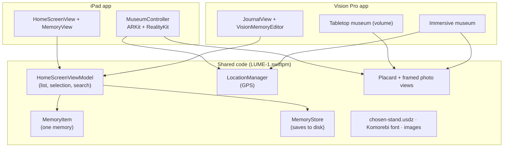
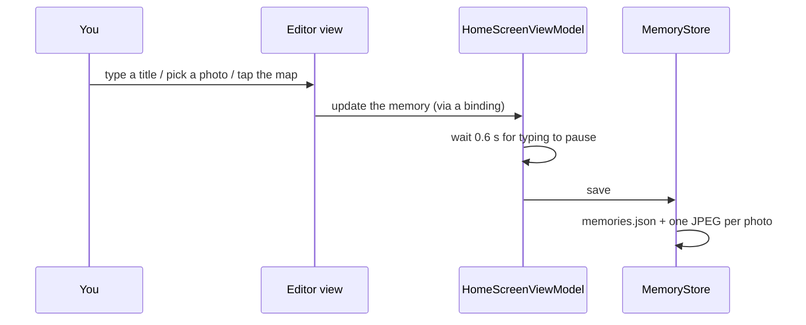
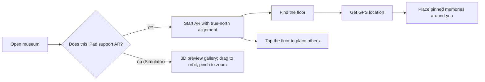

# How LUME Works

A friendly guide to what LUME is, which Apple technologies it uses on **iPad** and **Apple Vision Pro**, and how every feature works under the hood. No prior experience needed: each section starts with the idea in plain words, then shows where it lives in the code.

> **Two apps, one project.** The iPad app is `LUME-1.swiftpm` (on every branch). The Vision Pro app is `LUME-Vision/`, which lives on the [`visionos` branch](https://github.com/manav-Mnv/L-U-M-E/tree/visionos). They share most of their code.

---

## Contents

1. [What LUME does](#1-what-lume-does)
2. [The big picture](#2-the-big-picture)
3. [Technologies used](#3-technologies-used)
4. [How each feature works](#4-how-each-feature-works)
5. [The GPS → room math](#5-the-gps--room-math)
6. [File-by-file map](#6-file-by-file-map)
7. [Running it yourself](#7-running-it-yourself)
8. [Glossary](#8-glossary)

---

## 1. What LUME does

LUME (**L**ight **U**nveils **M**emory **E**nvironment) is a journal you can walk through.

1. **Write a memory**: a title, a photo, a story, and the place it happened (pinned on a map).
2. **Open the museum**: every memory becomes a 3D museum podium with its photo framed on top and a placard with its story.
3. **Walk around it**: the podiums stand in your real room. Memories pinned on the map stand **in the real compass direction of where they happened**, with a caption like *“1.2 km away · NE”*.

| | iPad | Apple Vision Pro |
| :--- | :--- | :--- |
| Journal | Split view: list + editor | Glass window: list + editor |
| Museum | AR through the iPad camera | **Tabletop** miniature + **life-size** around you |
| Photos | Library or camera | Photos library (apps can't use Vision Pro's cameras) |
| Finding north | iPad compass (automatic) | You face north once and pinch **Set North** |
| Without AR (Simulator) | Interactive 3D preview gallery | Tabletop + immersive museum work in the simulator |

---

## 2. The big picture



The app follows **MVVM** (Model, View, ViewModel):

- **Model**, `MemoryItem`: the data for one memory (id, title, story, photo, latitude/longitude, date).
- **ViewModel**, `HomeScreenViewModel`: owns the list of memories, which one is selected, search text, and add/delete/duplicate. Views never edit the array directly.
- **Views**: SwiftUI screens that show the data and send user actions to the view model.

---

## 3. Technologies used

### Shared by both apps

| Technology | What it is | What LUME uses it for |
| :--- | :--- | :--- |
| **Swift 6** | Apple's programming language, with strict checks that prevent data races | All code |
| **SwiftUI** | Apple's way to build UI by describing it | Every screen, card and button |
| **Combine / `ObservableObject`** | Lets views update automatically when data changes | `HomeScreenViewModel`, `LocationManager` |
| **RealityKit** | Apple's 3D engine | Podiums, materials, animations, gestures |
| **USDZ** | Apple's 3D file format | `chosen-stand.usdz`, the museum stand (modelled in Blender) |
| **`ImageRenderer`** | Turns a SwiftUI view into an image | Renders the placard and framed photo, then uses them as 3D textures |
| **MapKit** (`Map`, `MapReader`, `Marker`) | Apple Maps inside the app | Tap the map to pin where a memory happened |
| **Core Location** | GPS / location services | "Use My Location" and GPS placement in the museum |
| **`Codable` + `FileManager`** | Save Swift data as JSON files | Memories survive closing the app |
| **Core Text** | Low-level font handling | Registers the custom *Komorebi* font |

### iPad only

| Technology | What LUME uses it for |
| :--- | :--- |
| **App Playground (`.swiftpm`)** | The project format for the Swift Student Challenge. `Package.swift` sets it to iPad-only and declares the camera/location permissions |
| **ARKit** — `ARWorldTrackingConfiguration` | Tracks the iPad's position in the room and finds the floor (plane detection) |
| **ARKit** — `worldAlignment = .gravityAndHeading` | Lines the AR world up with **true north** using the compass, so GPS directions map straight into the room |
| **ARKit** — `ARReferenceImage` | Recognises a printed memory photo and places a miniature podium on it |
| **ARKit** — people occlusion | Your hands and body appear *in front of* podiums |
| **`ARCoachingOverlayView`** | Apple's built-in "move your iPad to find a surface" guide |
| **RealityKit `ARView`** | Shows the camera with 3D content; `raycast` finds the floor where you tap; `installGestures` adds drag/pinch/rotate |
| **UIKit interop** (`UIViewRepresentable`) | Wraps `ARView`, the camera (`UIImagePickerController`) and photo library (`PHPickerViewController`) for SwiftUI |
| **`NavigationSplitView`** | The iPad sidebar + detail layout |

### Vision Pro only

| Technology | What LUME uses it for |
| :--- | :--- |
| **Xcode project** (`LUME-Vision.xcodeproj`) | App Playgrounds can't target visionOS, so the Vision Pro app is a normal Xcode project that *references* the shared files |
| **`WindowGroup`** | The journal window |
| **Volumetric window** (`.windowStyle(.volumetric)`) | The 1.3 × 0.7 × 1.0 m **tabletop museum** that sits next to your other apps |
| **`ImmersiveSpace`** (mixed) | The **life-size museum** around you; your room stays visible |
| **`RealityView` + attachments** | Puts 3D content and real SwiftUI panels (control panel, story cards) into space |
| **Ornaments** + `glassBackgroundEffect` | Floating glass toolbars under windows |
| **Entity gestures** — `SpatialTapGesture`, `DragGesture`, `RotateGesture3D`, `MagnifyGesture` | Look + pinch to select, drag to move, two hands to turn or resize |
| **`InputTargetComponent`, `CollisionComponent`, `HoverEffectComponent`** | Make podiums respond to your eyes and hands, and glow when you look at them |
| **`BillboardComponent`** | Keeps story cards turned toward you |
| **Custom `Component`** (`PodiumComponent`) | Tags each podium with its memory's id, so a pinch knows which memory you touched |
| **ARKit for visionOS** — `ARKitSession` + `WorldTrackingProvider` | Reads where your head is and which way you face (used for **Set North** and to turn podiums toward you) |
| **`PhotosPicker`** | Choose photos (the Vision Pro camera isn't available to apps) |
| **Layered app icon** (`.solidimagestack`) | The 3D-style visionOS app icon |
| **Observation** (`@Observable`) | Modern state tracking for the museum models |

---

## 4. How each feature works

### Writing and saving a memory



- **Selection by ID.** The selected memory is stored by its unique ID, not by its position in the list, so deleting a memory while it's open can never crash the app.
- **Photos are prepared once.** `UIImage.preparedForMemory()` fixes the photo's rotation and shrinks it to at most 2048 px. Saving, 3D textures and AR image detection all stay light.
- **Saving waits for you.** Saves are *debounced*: the app waits 0.6 s after your last change, so typing doesn't write to disk on every key.
- **Where it's stored:** `Application Support/LUME/memories.json`, plus `images/<id>.jpg` for each photo.

### Turning a memory into a podium

Every podium is built the same way on both platforms (`makePodium` in the iPad's `ARMuseumView.swift`, `PodiumFactory.swift` on Vision Pro):

1. **Clone the stand.** The `chosen-stand.usdz` model is loaded once, asynchronously, then copied for each memory. If it ever fails to load, a simple marble plinth is built in code instead.
2. **Render the placard.** `DescriptionContainerView` (title, story, location, distance) is rendered by `ImageRenderer` into a **2000 × 1200** image. That matches the **0.5 m × 0.3 m** placard plane, so nothing is stretched.
3. **Render the framed photo.** `ImageContainerView` becomes a **1152 × 1536** image for the **0.72 m × 0.96 m** frame.
4. **Use unlit materials.** The images become `UnlitMaterial` textures, so the text stays readable in any lighting.
5. **Cache the textures.** They're stored per memory, so moving or re-placing a podium never re-renders them.
6. **Add a touch box.** One collision box around the whole podium lets you tap, grab and look at it.

### iPad: the AR museum



- **Floor detection.** ARKit reports flat surfaces. A surface counts as the floor only if it's at least 0.8 m below the iPad, which skips table tops.
- **Tap to place.** A *raycast* from your finger finds the floor point, and the podium is turned to face you.
- **Photo markers.** Each memory photo is checked (validated) as an AR marker first. Photos with too little detail are skipped instead of breaking the AR session.
- **Simulator fallback.** With no camera, `MuseumController` switches to a virtual gallery: podiums stand on an arc, you drag to look around, and tapping a card swings that podium to the front.

### Vision Pro: three ways to see memories

**Journal window.** The same list and editor as the iPad, in visionOS glass. Look at a spot on the map and pinch to pin it. *Tabletop Museum* and *Walk Through Museum* buttons float underneath in an ornament.

**Tabletop museum (volume).** A miniature rotunda:

- Podiums are scaled to 17% (about 36 cm tall) and stand on a turntable, facing outward.
- Drag the table to spin it; when you let go, it settles on the nearest podium.
- Pinch a podium, or a card in the panel below, and the turntable rotates it to the front with a glowing disc under it.

**Life-size museum (immersive space).**

- The immersive space's origin is **on the floor under you**, so podiums simply stand at height 0.
- An invisible 40 × 40 m "floor" catches your pinch: look at the floor, pinch, and the selected memory appears there.
- **Set North:** Vision Pro has no compass, so you face north (e.g. using the Compass app on your iPhone) and pinch *Set North*. LUME records your facing direction from `WorldTrackingProvider` and treats it as north.
- Pinned memories are then placed in their real directions (see the math below).
- Pinch a podium to show its story card above it. Drag to move it, twist with two hands to turn it, pinch with two hands to resize it.

---

## 5. The GPS → room math

The same idea on both platforms, in `ARMuseumView.swift` (iPad) and `GeoPlacement.swift` (Vision Pro).

**1. Which way?** The *bearing* from you to the memory, in degrees clockwise from north, uses the standard great-circle formula:

```
y = sin(Δlongitude) × cos(lat₂)
x = cos(lat₁) × sin(lat₂) − sin(lat₁) × cos(lat₂) × cos(Δlongitude)
bearing = atan2(y, x)
```

**2. How far?** A memory 500 km away can't stand 500 km away in your living room, so real distance is squeezed into a walkable distance:

| Real distance | Distance in the room |
| :--- | :--- |
| up to 3 m | the same, but at least 1.6 m away from you |
| more than 3 m | `3 + log₁₀(distance ÷ 3) × 1.4`, at most **8 m** |

So 30 m → about 4.4 m, 1 km → about 6.5 m, and anything past roughly 11 km stands at 8 m.

**3. Point it into the room.**
- **iPad:** ARKit's `gravityAndHeading` mode already makes −Z point north and +X point east, so the bearing turns straight into a direction.
- **Vision Pro:** the calibrated north direction is rotated clockwise by the bearing.

**4. Don't collide.** If two podiums would land closer than about 1.2–1.4 m, the later one is pushed further out along its direction.

**5. Face you.** Every podium's front is turned toward where you're standing: `yaw = atan2(dx, dz)`.

---

## 6. File-by-file map

### Shared code (`LUME-1.swiftpm`)

| File | What it does |
| :--- | :--- |
| `Models/MemoryItem.swift` | One memory, plus `displayTitle`, `locationString` and the save format |
| `ViewModels/HomeScreenViewModel.swift` | The memory list, selection by ID, search, add/delete/duplicate, auto-save |
| `Services/MemoryStore.swift` | Reads and writes `memories.json` and the photo files |
| `Services/LocationManager.swift` | Asks for location permission and streams GPS updates |
| `Helpers/UIImage+Resize.swift` | Fixes photo rotation and shrinks photos |
| `Helpers/Color+BrandColors.swift` | LUME's indigo brand colours |
| `Views/Components/DescriptionContainerView.swift` | The museum placard (becomes a 3D texture) |
| `Views/Components/ImageContainerView.swift` | The framed photo (becomes a 3D texture) |
| `Views/Components/MemoryCard.swift` | A row in the memory list |
| `Views/Screens/LumeIntroView.swift` | The animated "LUME" title screen |
| `Views/Screens/UnveilStoryView.swift` | The glass onboarding card (drag it to tilt it) |
| `Resources/chosen-stand.usdz` | The 3D museum stand |
| `Resources/Komorebi-PersonalUse.otf` | The custom font |

### iPad app only

| File | What it does |
| :--- | :--- |
| `Package.swift` | App settings: iPad-only, permissions, icon |
| `MyApp.swift` | App start, font registration, intro → onboarding → home flow |
| `Views/Screens/HomeScreenView.swift` | Sidebar + editor, search, swipe/long-press actions, museum button |
| `Views/Components/MemoryView.swift` | The memory editor: title, photo, story, map |
| `Views/Screens/MuseumView.swift` | The full-screen museum's buttons, status and memory picker |
| `Views/Screens/ARMuseumView.swift` | `MuseumController`: AR session, floor, GPS placement, tap placement, preview gallery, podium loading |
| `Views/Components/CameraView.swift`, `PhotoPickerView.swift` | Camera and photo library wrappers |

### Vision Pro app only (`LUME-Vision/`, on the `visionos` branch)

| File | What it does |
| :--- | :--- |
| `LUMEVision/LUMEVisionApp.swift` | Declares the journal window, tabletop volume and immersive space |
| `LUMEVision/MuseumSession.swift` | State shared between windows (is the museum open, which memory to focus) |
| `LUMEVision/Journal/JournalRootView.swift` | Intro → onboarding → journal |
| `LUMEVision/Journal/JournalView.swift` | Sidebar + editor in a visionOS window |
| `LUMEVision/Journal/VisionMemoryEditor.swift` | Editor with Photos picker and map pinning |
| `LUMEVision/Journal/MuseumOrnament.swift` | Floating buttons to open either museum |
| `LUMEVision/Museum/PodiumFactory.swift` | Builds podiums (shared look, gaze glow, touch box) |
| `LUMEVision/Museum/GeoPlacement.swift` | Bearing, distance squeeze, captions, north rotation |
| `LUMEVision/Museum/TabletopMuseumModel.swift` / `TabletopMuseumView.swift` | The turntable museum and its panel |
| `LUMEVision/Museum/ImmersiveMuseumModel.swift` / `ImmersiveMuseumView.swift` | The life-size museum: Set North, GPS placement, floor pinch, gestures |
| `LUMEVision/Museum/MemoryInfoCard.swift` | The floating story card |
| `LUMEVision-Info.plist` | Scene setup, location permission text, font |

---

## 7. Running it yourself

- **iPad:** open `LUME-1.swiftpm` in Xcode (open the `.swiftpm` folder itself), choose an iPad simulator or your iPad, and press **⌘R**.
- **Vision Pro:** switch to the `visionos` branch, open `LUME-Vision/LUME-Vision.xcodeproj`, choose **Apple Vision Pro**, and press **⌘R**.

In the visionOS Simulator, a click is a pinch, click-and-drag drags, Option-drag does two-hand gestures, and W A S D walks around. Full steps are in the [README](README.md).

> Real AR (floor detection, compass/north, people occlusion) needs a real iPad or Vision Pro. The simulators show everything else.

---

## 8. Glossary

| Word | Meaning |
| :--- | :--- |
| **SwiftUI view** | A piece of UI described in code, e.g. a card or a button |
| **Binding** | A two-way link: the editor changes the memory, and the memory updates the editor |
| **Entity** | Any object in a RealityKit 3D scene (a podium, a placard, a light) |
| **Anchor** | Pins 3D content to a real place, like a spot on the floor |
| **Texture** | An image wrapped onto a 3D surface |
| **Raycast** | Shooting an invisible line from your finger into the scene to see what it hits |
| **Plane detection** | ARKit finding flat surfaces such as floors and tables |
| **Bearing** | A compass direction, measured clockwise from north |
| **Volume** | A visionOS window with depth, holding 3D content |
| **Immersive space** | visionOS content that surrounds you instead of sitting in a window |
| **Ornament** | A floating toolbar attached to a visionOS window |
| **Debounce** | Waiting for activity to pause before acting (e.g. saving) |
| **MVVM** | Model–View–ViewModel: keeping data, logic and screens separate |
